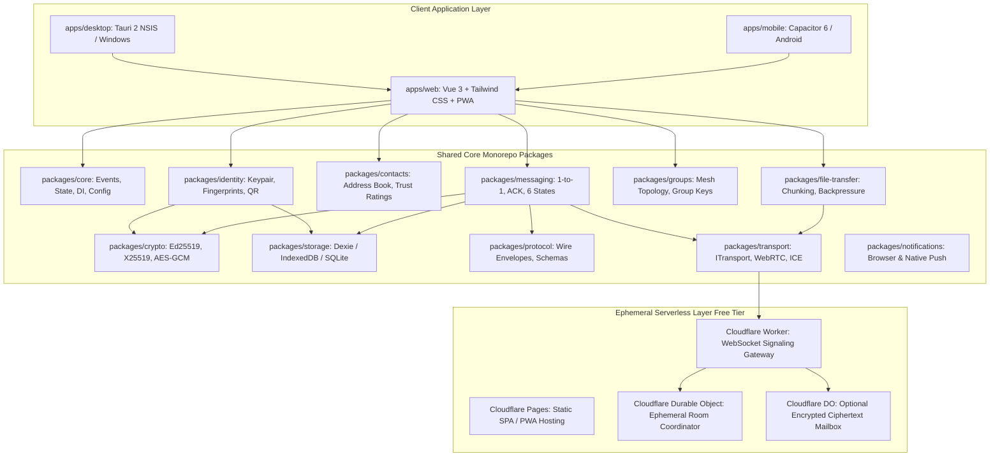
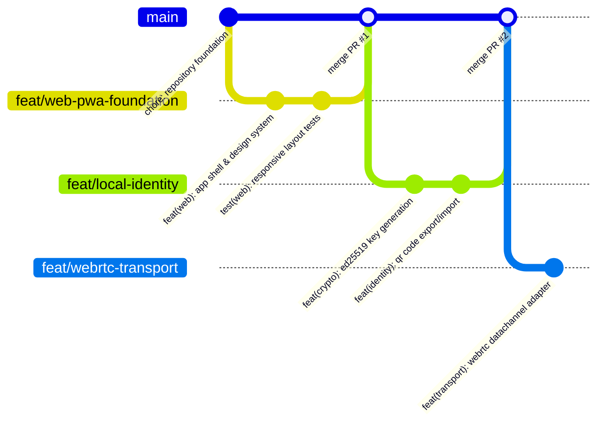
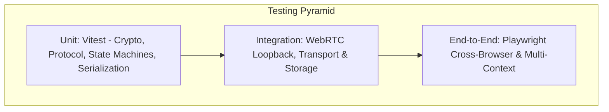

# CampusMesh: Master Implementation Plan & Engineering Specification

> **Document Type:** Production Engineering & Autonomous Development Master Plan  
> **Target System:** Decentralized, Zero-Cost, Cross-Platform P2P Communication Platform  
> **Development Methodology:** Feature-Driven, Branch-Isolated, Open-Source Collaborative  
> **Repository Root:** `A:\Projects\CampusMesh`  
> **Author:** Antigravity Engineering System

---

## 1. Executive Summary & Core Architectural Principles

CampusMesh is an enterprise-grade, privacy-first peer-to-peer (P2P) communication platform tailored for campus communities and decentralized private messaging. The platform establishes direct, end-to-end encrypted WebRTC communication channels between user devices, backed by an ephemeral, zero-cost serverless signaling mesh on Cloudflare (Workers + Durable Objects with SQLite).

### 1.1 Non-Negotiable Engineering Guardrails

1. **Zero Recurring Infrastructure Expenditure:**
   - No paid VPS, managed databases, commercial TURN subscriptions, or paid third-party APIs.
   - All serverless infrastructure operates strictly within free quotas (Cloudflare Pages Free, Cloudflare Workers Free, Durable Objects Free Tier, GitHub Actions free runner allocations).
   - If free quotas are exceeded or infrastructure is unreachable, the client software **must degrade gracefully** to pure direct local-mesh mode rather than failing or incurring costs.
2. **True Decentralization & Zero-Knowledge Architecture:**
   - Central servers (including the Cloudflare signaling worker) **never** handle message plaintext, store permanent user directories, or retain private keys.
   - User identities are decentralized, cryptographic keypairs (Ed25519 / X25519) generated locally on-device. No email or phone registration is required.
3. **Local-First Persistence:**
   - Conversations, contacts, cryptographic keystores, and attachments are persisted locally (IndexedDB via Dexie for Web/PWA, SQLite/Filesystem for Desktop/Mobile).
4. **Feature-by-Feature Branching Discipline:**
   - Every capability is developed in an isolated feature branch with dedicated automated unit/integration tests, strict architectural boundaries, and explicit acceptance criteria before merging into `main`.
5. **Cross-Platform Shared Logic:**
   - Core cryptography, messaging protocols, storage abstractions, and transport management reside in platform-agnostic TypeScript packages shared across the Web (PWA), Desktop (Windows via Tauri 2), and Mobile (Android via Capacitor).

---

## 2. System Architecture & Component Model



---

## 3. Monorepo Structure & Package Boundaries

The repository is organized as a strict `pnpm` monorepo enforcing dependency boundaries via TypeScript project references and lint rules.

```text
campusmesh/
├── apps/
│   ├── web/                         # Vue 3 SPA + Vite + Tailwind + PWA
│   ├── desktop/                     # Tauri 2 Desktop app (Windows NSIS target)
│   └── mobile/                      # Capacitor Android app
│
├── packages/
│   ├── shared-types/                # Core TypeScript DTOs, Enums, Type definitions
│   ├── crypto/                      # Ed25519, X25519, Argon2id, AES-256-GCM, SHA-256
│   ├── storage/                     # Dexie / IndexedDB abstraction layer & schema migrations
│   ├── protocol/                    # Wire protocol serialization, envelopes, validation
│   ├── transport/                   # ITransportAdapter, WebRTC DataChannels, STUN/ICE
│   ├── identity/                    # Cryptographic identity lifecycle, QR code gen/scan
│   ├── contacts/                    # Contact address book, invitations, verification
│   ├── messaging/                   # 1-to-1 chat engine, 6-state delivery tracking
│   ├── groups/                      # Small-group mesh coordinator, group membership events
│   ├── file-transfer/               # Chunked binary streaming, flow control, integrity checks
│   ├── notifications/               # Platform-agnostic notification adapter
│   └── ui/                          # Shared UI component primitives & Tailwind preset
│
├── infrastructure/
│   └── cloudflare/
│       ├── signaling-worker/        # WebSocket signaling gateway
│       ├── room-coordinator/        # Durable Object ephemeral room manager (SQLite)
│       ├── encrypted-mailbox/       # Optional TTL-bound ciphertext relay
│       └── wrangler.toml            # Cloudflare deployment manifest
│
├── docs/
│   ├── ARCHITECTURE.md              # High-level architecture specification
│   ├── SECURITY.md                  # Security policies and vulnerability reporting
│   ├── THREAT_MODEL.md              # Threat vectors, mitigations & cryptographic boundaries
│   ├── COST_POLICY.md               # Infrastructure zero-budget guarantee & degradation rules
│   ├── CONTRIBUTING.md              # Contributor guide & development workflow
│   ├── BRANCHING_STRATEGY.md        # Branching model & commit conventions
│   ├── ROADMAP.md                   # Chronological feature roadmap
│   ├── IMPLEMENTATION_STATUS.md     # Real-time tracking of modules & acceptance criteria
│   ├── PROTOCOL_SPECIFICATION.md    # Wire packet definitions & cryptographic handshakes
│   ├── API_CONTRACTS.md             # Package public interfaces & adapter contracts
│   └── adr/                         # Architecture Decision Records (ADR-001 to ADR-010)
│
├── .github/
│   ├── ISSUE_TEMPLATE/              # Feature request, Bug report, Security issue templates
│   ├── workflows/                   # CI/CD pipelines (test, build, deploy, release)
│   ├── PULL_REQUEST_TEMPLATE.md     # Mandatory PR checklist & verification gates
│   └── CODEOWNERS                   # Maintainer review rules
│
├── tests/
│   ├── unit/                        # Root unit test configuration
│   ├── integration/                 # Multi-package integration & WebRTC loopback tests
│   ├── e2e/                         # Playwright cross-browser multi-context tests
│   └── security/                    # Replay, tampering, and invalid signature fuzzing
│
├── pnpm-workspace.yaml              # Monorepo workspace configuration
├── package.json                     # Root scripts, husky, lint-staged, devDependencies
├── tsconfig.base.json               # Shared strict TypeScript configuration
└── vitest.workspace.ts              # Unified Vitest test runner config
```

---

## 4. Feature-by-Feature Git Branching & Collaboration Governance

To support professional, enterprise-grade engineering and frictionless multi-contributor collaboration, all development follows strict Git branching protocols.

### 4.1 Branching Strategy



### 4.2 Branch Taxonomy & Naming Rules

| Branch Prefix            | Purpose                                                   | Base Branch | Target Branch   |
| ------------------------ | --------------------------------------------------------- | ----------- | --------------- |
| `main`                   | Production-ready, deployable code only                    | N/A         | Protected       |
| `feat/<feature-slug>`    | Implementation of a specific functional module            | `main`      | `main` via PR   |
| `fix/<bug-slug>`         | Bug fix with regression test                              | `main`      | `main` via PR   |
| `security/<patch-slug>`  | Cryptographic fix or security vulnerability patch         | `main`      | `main` via PR   |
| `docs/<doc-slug>`        | Technical documentation or ADR updates                    | `main`      | `main` via PR   |
| `test/<test-slug>`       | Test harness, mock adapters, or benchmark additions       | `main`      | `main` via PR   |
| `chore/<task-slug>`      | Toolchain, workspace configuration, or dependency updates | `main`      | `main` via PR   |
| `experiment/<tech-slug>` | R&D explorations (e.g., Holepunch Pear/Hyperswarm)        | `main`      | Isolated branch |

### 4.3 Commit Message Convention (Conventional Commits)

Every commit must follow the format: `<type>(<scope>): <short description>`

- **Types:** `feat`, `fix`, `docs`, `style`, `refactor`, `perf`, `test`, `build`, `ci`, `chore`, `security`.
- **Scopes:** `web`, `desktop`, `mobile`, `crypto`, `storage`, `protocol`, `transport`, `identity`, `messaging`, `groups`, `signaling`.

### 4.4 Definition of Done (DoD) per Feature Branch

Before any pull request can be merged into `main`:

1. **Zero Type Errors:** `pnpm typecheck` passes cleanly across all packages.
2. **Lint & Style Cleanliness:** `pnpm lint` and `pnpm format:check` pass without warnings.
3. **Automated Test Coverage:** New code includes unit and integration tests; all test suites pass (`pnpm test`).
4. **No Paid Dependencies:** Verified zero dependencies requiring commercial licenses or paid cloud tokens.
5. **Documentation Updated:** `IMPLEMENTATION_STATUS.md`, `ROADMAP.md`, and relevant package documentation updated.
6. **Isolated Scope:** The branch touches only the files necessary for that feature.

---

## 5. Phase-by-Phase Engineering Roadmap

```mermaid
flowchart LR
    P0["Phase 0: Foundation\n(chore/repository-foundation)"] --> P1["Phase 1: Web PWA Shell\n(feat/web-pwa-foundation)"]
    P1 --> P2["Phase 2: Local Identity\n(feat/local-identity)"]
    P2 --> P3["Phase 3: Transport & Signaling\n(feat/webrtc-transport\nfeat/cloudflare-signaling)"]
    P3 --> P4["Phase 4: Direct E2EE Messaging\n(feat/direct-messaging)"]
    P4 --> P5["Phase 5: Contacts & Groups\n(feat/contact-management\nfeat/group-messaging)"]
    P5 --> P6["Phase 6: Chunked File Transfer\n(feat/p2p-file-transfer)"]
    P6 --> P7["Phase 7: Offline Sync & Mailbox\n(feat/offline-sync)"]
    P7 --> P8["Phase 8: Native Desktop & Mobile\n(feat/desktop-tauri\nfeat/android-capacitor)"]
    P8 --> P9["Phase 9: Voice & Video Calls\n(feat/voice-messages\nfeat/voice-calls)"]
    P9 --> P10["Phase 10: Advanced Decentralized Mesh\n(experiment/pear-hyperswarm)"]
```



### Detailed Phase Specifications

#### Phase 0: Engineering Foundation & Monorepo Infrastructure

- **Branch:** `chore/repository-foundation`
- **Scope:** Root workspace, toolchain, documentation, CI workflows.
- **Deliverables:**
  - `pnpm-workspace.yaml` and root `package.json` with scripts (`build`, `test`, `lint`, `typecheck`).
  - Shared TypeScript configurations (`tsconfig.base.json`).
  - ESLint 9 (flat config) + Prettier + Husky git pre-commit hooks + lint-staged.
  - Vitest workspace configuration for monorepo packages.
  - Initial core governance documents: `ARCHITECTURE.md`, `CONTRIBUTING.md`, `SECURITY.md`, `THREAT_MODEL.md`, `COST_POLICY.md`, `BRANCHING_STRATEGY.md`, `IMPLEMENTATION_STATUS.md`.
  - Architecture Decision Records: `ADR-001` (Monorepo & Workspace Tooling), `ADR-002` (WebRTC + Serverless Signaling Topology), `ADR-003` (Zero-Cost Infrastructure Boundary).
  - GitHub Actions CI workflow (`.github/workflows/ci.yml`).
- **Acceptance Criteria:** `pnpm test`, `pnpm lint`, and `pnpm build` run cleanly across the workspace in CI.

#### Phase 1: Web Application Shell & Design System

- **Branch:** `feat/web-pwa-foundation`
- **Packages/Apps:** `apps/web`, `packages/ui`
- **Deliverables:**
  - Vue 3 + Vite + Tailwind CSS + Lucide Icons + Pinia + Vue Router application skeleton.
  - Responsive layout engine: Desktop multi-pane layout (Navigation sidebar, Conversation list, Chat viewport, Details drawer) and Mobile single-view bottom-tab navigation.
  - Theme engine: Refined Dark and Light themes with system auto-detection and high contrast mode.
  - PWA Integration: `vite-plugin-pwa` with offline caching service worker and Web App Manifest.
  - Base UI components: Button, Input, Modal, Avatar, Badge, Toast, Tooltip.
- **Acceptance Criteria:** Responsive UI renders seamlessly across desktop (1920x1080) and mobile viewports (375x667). PWA passes Lighthouse audit for installability.

#### Phase 2: Cryptographic Identity Engine

- **Branch:** `feat/local-identity`
- **Packages:** `packages/crypto`, `packages/storage`, `packages/identity`
- **Deliverables:**
  - `@campusmesh/crypto`: Pure cryptographic primitives using `libsodium-wrappers` and Web Crypto API. Ed25519 signing keypairs and X25519 key-exchange keypairs.
  - `@campusmesh/identity`: Identity manager creating local profiles (Public Key, Encrypted Private Key, SHA-256 fingerprint, Display Name, local avatar).
  - QR Code generator and scanner integration (`@zxing/library` or lightweight WebAssembly/Canvas scanner).
  - Encrypted identity export/import: Passphrase-derived encryption via Argon2id + AES-256-GCM.
  - `@campusmesh/storage`: Dexie IndexedDB schemas for identities, cryptographic keys, and settings.
- **Acceptance Criteria:** User can generate identity, view fingerprint, scan/render QR identity cards, export password-protected backup, and restore it on a clean browser. Private keys never leave local storage unencrypted.

#### Phase 3: Transport Layer & Serverless Signaling Mesh

- **Branches:** `feat/webrtc-transport` (Client) & `feat/cloudflare-signaling` (Infra)
- **Packages/Infra:** `packages/transport`, `packages/protocol`, `infrastructure/cloudflare`
- **Deliverables:**
  - `packages/transport`: `ITransportAdapter` interface abstraction. `WebRtcTransportAdapter` managing `RTCPeerConnection` and `RTCDataChannel`.
  - Connection lifecycle: SDP offer/answer negotiation, ICE candidate trickling, STUN fallback (Google/Cloudflare free public STUN servers), auto-reconnect with exponential backoff.
  - Cloudflare Worker + Durable Object SQLite (`infrastructure/cloudflare/signaling-worker`):
    - Ephemeral room coordination via WebSockets.
    - Zero plaintext message storage; relays only encrypted SDP and ICE signals.
    - Strict WebSocket hibernation to conserve CPU limits.
    - Automatic state expiry and rate limiting per IP/session.
- **Acceptance Criteria:** Two independent browser sessions exchange SDP/ICE through the Cloudflare Durable Object and establish a direct WebRTC DataChannel. Network diagnostics panel displays connection state and latency.

#### Phase 4: Direct E2EE Messaging Engine

- **Branch:** `feat/direct-messaging`
- **Packages:** `packages/protocol`, `packages/messaging`, `packages/storage`, `apps/web`
- **Deliverables:**
  - Message wire format: Signed envelopes containing payload ciphertext, sender fingerprint, timestamp, message ID, and ephemeral nonce.
  - Authenticated encryption: X25519 ECDH shared secret derivation + AES-256-GCM encryption with replay protection.
  - 6-State Delivery Tracking:
    1. `SAVED_LOCALLY` (Persisted in IndexedDB)
    2. `CONNECTING` (Awaiting peer connection)
    3. `SENT` (Transmitted over DataChannel)
    4. `DELIVERED` (Cryptographic ACK received from recipient)
    5. `READ` (Read receipt ACK received)
    6. `FAILED` (Network timeout / peer unreachable)
  - Chat UI: Message timeline, optimistic UI updates, delivery state checkmarks, inline reactions, timestamps, and search.
- **Acceptance Criteria:** End-to-end messaging functions between two browsers on separate networks with full delivery ACK lifecycle. Zero plaintext passes through signaling.

#### Phase 5: Contact Management & Group Mesh

- **Branches:** `feat/contact-management` & `feat/group-messaging`
- **Packages:** `packages/contacts`, `packages/groups`, `packages/storage`, `apps/web`
- **Deliverables:**
  - Contact management: Add contact via QR or secure invite link (`campusmesh://invite/...`), fingerprint trust verification (Safety Numbers), block list.
  - Group Mesh engine: Small-group full mesh (bounded to 6–8 active peers).
  - Authenticated membership: Group creation, cryptographic group invite tokens, signed member join/leave/kick events.
  - Group chat UI: Member list, group roles (Owner, Admin, Member), group avatar, group message broadcasting.
- **Acceptance Criteria:** Group chat operates smoothly across 4 simultaneous connected browser peers. Unauthorized or tampered group messages are rejected.

#### Phase 6: Chunked P2P File Transfer

- **Branch:** `feat/p2p-file-transfer`
- **Packages:** `packages/file-transfer`, `packages/transport`, `apps/web`
- **Deliverables:**
  - Binary streaming over WebRTC DataChannel using 16KB/64KB chunking.
  - Backpressure monitoring via `bufferedAmount` and `bufferedAmountLowThreshold`.
  - In-flight SHA-256 hashing for end-to-end integrity validation.
  - Transfer state machine: Progress tracking, pause, cancel, and auto-resume.
  - File preview support: Images, audio/video playback, and document downloads.
- **Acceptance Criteria:** 100MB file successfully transfers directly between two peers with active progress bar, zero memory leaks, and verified SHA-256 checksum upon completion.

#### Phase 7: Offline Resilience & Encrypted Mailbox

- **Branch:** `feat/offline-sync`
- **Packages/Infra:** `packages/messaging`, `infrastructure/cloudflare/encrypted-mailbox`
- **Deliverables:**
  - Local Outbox queue: Unsent messages queue in IndexedDB and automatically flush when peer reconnects.
  - Optional Free Encrypted Mailbox:
    - Cloudflare Durable Object temporary store for encrypted ciphertext.
    - Strict 48-hour TTL, 50-message cap per recipient, authenticated submission via Ed25519 signature.
    - Automatic deletion immediately upon recipient download and ACK.
- **Acceptance Criteria:** Sender posts a message while recipient is offline. Once recipient opens the app, ciphertext is fetched, decrypted, ACKed, and purged from the mailbox.

#### Phase 8: Cross-Platform Native Applications (Tauri 2 & Capacitor)

- **Branches:** `feat/desktop-tauri` & `feat/android-capacitor`
- **Apps:** `apps/desktop`, `apps/mobile`
- **Deliverables:**
  - **Desktop (Windows NSIS):**
    - Tauri 2 integration embedding the shared Vue application.
    - Windows NSIS installer configuration with custom icons and protocol registration (`campusmesh://`).
    - Tauri official auto-updater configured with GitHub Releases and Ed25519 update signature verification.
  - **Mobile (Android APK):**
    - Capacitor 6 configuration targeting Android SDK 34+.
    - Android APK build pipeline via GitHub Actions.
    - In-app update checker querying GitHub Releases, downloading APK, and triggering Android PackageInstaller handoff.
- **Acceptance Criteria:** Windows NSIS `.exe` installer builds and runs natively. Android debug APK builds and installs on an emulator/device.

#### Phase 9: Voice Messages & Calling

- **Branches:** `feat/voice-messages` & `feat/voice-calls`
- **Packages:** `packages/messaging`, `packages/transport`, `apps/web`
- **Deliverables:**
  - Voice notes: Audio recording via `MediaRecorder` (Opus/WebM), waveform visualization, chunked encrypted P2P transfer, inline audio player.
  - 1-to-1 Voice & Video Calling: WebRTC media streams (`getUserMedia`), STUN ICE candidate negotiation, call ring/accept/reject signaling, screen sharing toggle.
- **Acceptance Criteria:** Two users can record and send voice notes, and initiate a direct P2P audio call with low latency.

#### Phase 10: Advanced Decentralized Mesh R&D (Pear/Hyperswarm)

- **Branch:** `experiment/pear-hyperswarm`
- **Deliverables:**
  - Isolated proof-of-concept evaluating Holepunch Pear, Hyperswarm, Hypercore, HyperDHT, and Autobase.
  - Benchmark report documenting NAT traversal rate, memory footprint, Windows and Android compatibility, and storage replication reliability vs WebRTC.
- **Acceptance Criteria:** Documented architectural decision record (`ADR-008`) with empirical benchmark data determining future adoption viability.

---

## 6. Testing Strategy & Quality Assurance Matrix



### 6.1 Test Suites by Package

| Package                     | Test Scope                                                                                                               | Tooling                 |
| --------------------------- | ------------------------------------------------------------------------------------------------------------------------ | ----------------------- |
| `packages/crypto`           | Keypair generation, signing, verification, shared secret derivation, encryption roundtrip, tampered ciphertext rejection | Vitest                  |
| `packages/protocol`         | Wire envelope serialization/deserialization, schema validation, replay counter tracking                                  | Vitest                  |
| `packages/storage`          | Dexie schema migrations, CRUD operations, outbox queries, atomic transactions                                            | Vitest + fake-indexeddb |
| `packages/transport`        | WebRTC connection state machine, mock signaling exchange, data channel chunking                                          | Vitest + Mock RTC       |
| `packages/identity`         | Profile lifecycle, QR payload encoding/decoding, passphrase key derivation                                               | Vitest                  |
| `packages/messaging`        | 1-to-1 delivery state transitions, deduplication, ACK processing                                                         | Vitest                  |
| `infrastructure/cloudflare` | Worker HTTP endpoints, Durable Object WebSocket messaging, TTL expiration                                                | Miniflare / Vitest      |
| `apps/web` (E2E)            | Multi-browser identity exchange, real WebRTC DataChannel connection, chat delivery                                       | Playwright              |

---

## 7. Zero-Cost Infrastructure & Quota Safeguards

To prevent unexpected billing or service termination:

1. **Cloudflare Free Tier Budget Protection:**
   - Cloudflare Workers Free: 100,000 requests/day.
   - Cloudflare Durable Objects Free: 50,000 requests/day, 1GB storage.
   - Cloudflare Pages Free: Unlimited bandwidth, 20,000 monthly build minutes.
   - **Protection Mechanism:** Signaling connections hibernate when idle. Ephemeral room data expires in 15 minutes.
2. **Degraded Pure-P2P Fallback Mode:**
   - If the Cloudflare signaling worker is offline or exceeds quota, the application displays a clear status banner: `"Signaling server unavailable - manual direct connect active"`.
   - Users can exchange manual connection tokens (copy-paste SDP/ICE or local LAN discovery) to connect without any external server.
3. **GitHub Actions Runner Optimization:**
   - Windows and Android builds only run on `main` merges or tagged releases to preserve monthly free runner quotas. Pull requests run lint, type-check, and unit tests on Linux runners.

---

## 8. Immediate Execution Plan: Phase 0 Action Items

To commence implementation immediately with industrial rigor:

- [ ] **Step 0.1:** Initialize the local Git repository and create `main` branch.
- [ ] **Step 0.2:** Create feature branch `chore/repository-foundation`.
- [ ] **Step 0.3:** Scaffold the root monorepo files:
  - `pnpm-workspace.yaml`
  - Root `package.json` with workspace devDependencies and lifecycle scripts.
  - `tsconfig.base.json` (strict TypeScript configuration).
  - `.gitignore`, `.prettierrc`, `eslint.config.js`.
  - Husky + lint-staged hooks.
  - Vitest workspace configuration.
- [ ] **Step 0.4:** Scaffold directory skeleton:
  - `apps/web`, `apps/desktop`, `apps/mobile`
  - `packages/shared-types`, `packages/crypto`, `packages/storage`, `packages/protocol`, `packages/transport`, `packages/identity`, `packages/contacts`, `packages/messaging`, `packages/groups`, `packages/file-transfer`, `packages/notifications`, `packages/ui`
  - `infrastructure/cloudflare`
  - `docs/` and `docs/adr/`
  - `.github/workflows/` and `.github/ISSUE_TEMPLATE/`
- [ ] **Step 0.5:** Author foundational documentation:
  - `docs/ARCHITECTURE.md`
  - `docs/CONTRIBUTING.md`
  - `docs/SECURITY.md`
  - `docs/THREAT_MODEL.md`
  - `docs/COST_POLICY.md`
  - `docs/BRANCHING_STRATEGY.md`
  - `docs/ROADMAP.md`
  - `docs/IMPLEMENTATION_STATUS.md`
  - `docs/adr/ADR-001-monorepo-architecture.md`
  - `docs/adr/ADR-002-webrtc-as-initial-transport.md`
  - `docs/adr/ADR-003-zero-cost-infrastructure-policy.md`
- [ ] **Step 0.6:** Establish GitHub Actions CI workflow (`.github/workflows/ci.yml`).
- [ ] **Step 0.7:** Verify all baseline scripts (`pnpm lint`, `pnpm typecheck`, `pnpm test`) succeed cleanly.
- [ ] **Step 0.8:** Prepare the pull request and merge `chore/repository-foundation` into `main`.

---

_This plan is ready for execution upon user confirmation. All subsequent development will proceed feature-by-feature across dedicated branches._
