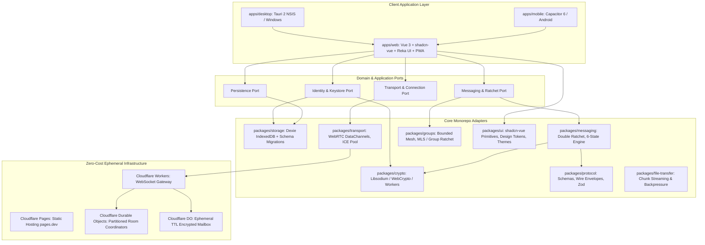
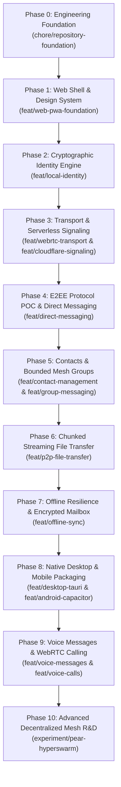

# CampusMesh: Master Implementation Plan & Engineering Specification

> **Document Type:** Production Engineering & Autonomous Development Master Specification  
> **Target System:** Decentralized, Zero-Cost, Scalable, High-Performance Cross-Platform P2P Communication Platform  
> **Development Methodology:** Feature-Driven, Branch-Isolated, Open-Source Collaborative  
> **Repository Root:** `A:\Projects\CampusMesh`  
> **Budget Constraint:** Exactly $0.00 / month (Strict Fail-Closed Free Tier Only)  
> **Frontend Stack:** Vue 3, TypeScript, Tailwind CSS, shadcn-vue, Reka UI, Lucide Icons, Vite, Pinia, Dexie  
> **Native Packaging:** Tauri 2 (Windows NSIS) & Capacitor 6 (Android)

---

## 1. Executive Summary & Core Architectural Manifesto

CampusMesh is a privacy-first, decentralized peer-to-peer (P2P) communication platform designed for college communities, student circles, and personal private communication.

### 1.1 The Three Core Architectural Priorities

1. **Prioritize Direct P2P Over Cloud Infrastructure:**  
   Cloudflare Workers and Durable Objects are strictly ephemeral coordinators for connection establishment. They never store plaintext, retain permanent message histories, or act as a compulsory messaging backbone. Direct communication happens device-to-device via WebRTC DataChannels and local-first persistence.
2. **Architect for a Scalable Network from Day One:**  
   Decouple peer discovery, transport, message replication, encryption, and local storage into cleanly isolated ports and adapters (Hexagonal Architecture). Any individual layer (e.g., migrating from WebRTC DataChannels to Hyperswarm/Autobase) can evolve without re-architecting the application.
3. **Treat Premium UX and Performance as Core Features:**  
   Decentralized architecture must never compromise speed, beauty, or ergonomics. The application features a dedicated, tokenized design system built with **shadcn-vue** and **Reka UI**, complete state coverage (connecting, offline, quota exhausted, permission denied), conversation virtualization, and WebWorker-offloaded cryptography.

---

## 2. Mandatory Principles & System Guardrails

### 2.1 The Zero-Cost Principle ($0.00 / month Hard Cap)

- **Zero Paid Dependencies:** No paid VPS, cloud databases, managed TURN services, commercial push gateways, paid domains, or proprietary SDKs.
- **Provider Domains Only:** Use free provider subdomains (e.g., `*.pages.dev`, `*.workers.dev`). No paid custom domain requirements.
- **Fail-Closed Protection:** All cloud infrastructure must be provisioned on free tiers that refuse paid overages. If a quota is exceeded:
  1. The affected optional service halts immediately.
  2. The UI displays an explicit diagnostic notice (e.g., _"Signaling quota reached for today — fallback to direct LAN/manual connection active"_).
  3. Outgoing messages remain queued safely in local IndexedDB.
  4. Established direct P2P connections continue unaffected.
- **Cost Policy Document:** Maintain `docs/COST_POLICY.md` tracking free quotas, usage formulas, fail-closed mechanics, and audit dates.

### 2.2 Scalability & Anti-Bottleneck Architecture

- **No Global Bottleneck Durable Object:** Durable Objects are partitioned by room/conversation identifier (`RoomCoordinatorDO`). Different conversations never share the same coordinator instance.
- **WebSocket Hibernation:** Workers and Durable Objects use Cloudflare WebSocket Hibernation API so idle connections consume zero CPU time.
- **Small-Group Mesh Benchmarking:** Unrestricted full-mesh is prohibited. WebRTC meshes are bounded (initially 2, 4, and 8 peers) with empirical CPU, memory, and bandwidth benchmarking before considering larger groups.
- **Decoupled Event Replication:** Text messaging uses deterministic, signed, immutable event IDs with vector clocks or append-only log primitives. Large group calling is explicitly separated from text replication.

### 2.3 Security-First Cryptography Mandate

- **No DIY Protocols:** Combining X25519 and AES-GCM primitives directly does _not_ constitute a production messaging protocol.
- **Protocol Proof of Concept:** We will evaluate established, formal ratcheting protocols:
  - **Double Ratchet / Signal Protocol:** For asynchronous 1-to-1 conversations with guaranteed Forward Secrecy (FS) and Post-Compromise Security (PCS).
  - **MLS (Messaging Layer Security, RFC 9420):** For scalable, cryptographically sound group rekeying.
- **Key Storage:** Secret keys are **never** stored in `localStorage` or transmitted across the network. Private keys reside in IndexedDB wrapped with Web Crypto non-extractable keys or encrypted with Argon2id-derived master keys.
- **Zero Sensitive Logging:** Never log private keys, plaintext payloads, or identity seeds to consoles or telemetry.

### 2.4 Premium UI/UX & Design System Standard

- **Design System Stack:** Vue 3 + Tailwind CSS + `shadcn-vue` + `Reka UI` + `lucide-vue-next`.
- **Complete UX State Machine:** Every component implements 14 explicit UX states:
  _Initial Loading_, _Empty_, _Offline_, _Connecting_, _Connected_, _Disconnected_, _Reconnecting_, _Failed_, _Permission Denied_, _Transfer In Progress_, _Transfer Interrupted_, _Update Available_, _Storage Unavailable_, and _Quota Exhausted_.
- **Accessibility:** Targeted to WCAG 2.2 AA with full keyboard navigation, screen-reader aria attributes, and reduced-motion preferences.
- **Multi-Pane Desktop & Mobile-First Handheld:** Multi-pane responsive layout for desktop (nav rail, conversation list, active chat, expandable inspection drawer) and single-surface bottom-tab layout with gesture support for mobile.

### 2.5 Performance & Resource Optimization

- **Virtualization:** Conversation message history virtualized using `@tanstack/vue-virtual` to ensure 60 FPS scrolling with 10,000+ messages.
- **Non-Blocking Cryptography:** Heavy cryptographic operations (ratchet turns, Argon2id key derivation, file chunk encryption) execute in Web Workers.
- **Streaming Transfer & Backpressure:** P2P file transfers stream chunks over WebRTC DataChannels using `bufferedAmount` and `bufferedAmountLowThreshold` flow control. Files are never read entirely into memory.
- **Performance Budget:** Enforce bundle size limits, tree-shaking, and performance budgets tracked in `docs/PERFORMANCE.md`.

---

## 3. High-Level Component Topology



---

## 4. Monorepo Architecture & Package Boundaries

```text
campusmesh/
├── apps/
│   ├── web/                         # Vue 3 SPA + Vite + Tailwind + shadcn-vue + PWA
│   ├── desktop/                     # Tauri 2 Desktop container (Windows NSIS target)
│   └── mobile/                      # Capacitor 6 Android container
│
├── packages/
│   ├── shared-types/                # Core domain types, DTOs, wire schemas
│   ├── crypto/                      # WebCrypto / Libsodium engine, WebWorker offload
│   ├── storage/                     # Dexie IndexedDB adapter, queries, migration pipeline
│   ├── protocol/                    # Zod wire schemas, envelope validation, serialization
│   ├── transport/                   # ITransportAdapter, WebRTC DataChannels, STUN/ICE pool
│   ├── identity/                    # Key generation, QR card generation/scanning
│   ├── contacts/                    # Contact book, safety numbers, trust verification
│   ├── messaging/                   # Ratchet engine, 6 delivery states, conversation model
│   ├── groups/                      # Bounded mesh coordinator (2, 4, 8 peers), group rekeying
│   ├── file-transfer/               # Chunked binary streaming, backpressure, SHA-256 checks
│   ├── notifications/               # Cross-platform notification port (Browser + Native)
│   └── ui/                          # Design tokens, shadcn-vue & Reka UI components
│
├── infrastructure/
│   └── cloudflare/
│       ├── signaling-worker/        # WebSocket routing gateway
│       ├── room-coordinator/        # Partitioned Durable Object room coordinator
│       ├── encrypted-mailbox/       # TTL-bound ciphertext relay (optional offline)
│       └── wrangler.toml            # Fail-closed free tier Cloudflare configuration
│
├── docs/
│   ├── ARCHITECTURE.md              # System design & hexagonal port/adapter architecture
│   ├── SECURITY.md                  # Security disclosure policy & cryptographic design
│   ├── THREAT_MODEL.md              # Threat vectors, mitigations & boundary defenses
│   ├── COST_POLICY.md               # Zero-budget policy, free limits & fail-closed rules
│   ├── PERFORMANCE.md               # Performance budgets, virtualization & profiling
│   ├── CONTRIBUTING.md              # Contributor guide & development workflow
│   ├── BRANCHING_STRATEGY.md        # Branch naming, stacked PRs & commit conventions
│   ├── ROADMAP.md                   # Real-time roadmap tracking
│   ├── IMPLEMENTATION_STATUS.md     # Feature verification matrix & Definition of Done
│   ├── PROTOCOL_SPECIFICATION.md    # Wire packet definitions & cryptographic handshakes
│   └── adr/                         # Architecture Decision Records
│
├── .github/
│   ├── ISSUE_TEMPLATE/              # Structured bug, feature, and security templates
│   ├── workflows/                   # Standard runner CI/CD pipelines
│   └── PULL_REQUEST_TEMPLATE.md     # Mandatory PR checklist & acceptance criteria
│
├── tests/
│   ├── unit/                        # Workspace-wide unit tests
│   ├── integration/                 # WebRTC loopback and multi-package integration
│   ├── e2e/                         # Playwright cross-browser multi-context tests
│   └── security/                    # Cryptographic fuzzing and replay tests
│
├── pnpm-workspace.yaml              # Monorepo workspace configuration
├── package.json                     # Root configuration, scripts, devDependencies
├── tsconfig.base.json               # Shared strict TypeScript configuration
└── vitest.workspace.ts              # Unified Vitest workspace runner
```

---

## 5. Feature-by-Feature Branching & Collaboration Governance

### 5.1 Branch Strategy & Rules

- **`main`:** Always deployable, stable, and protected. Direct commits are forbidden.
- **Short-Lived Branches:**
  - `feat/<feature-slug>`: Feature implementation.
  - `fix/<bug-slug>`: Bug fixes with regression tests.
  - `security/<patch-slug>`: Security enhancements or vulnerability fixes.
  - `docs/<doc-slug>`: Documentation, ADRs, or policy updates.
  - `test/<test-slug>`: Test suites, mocks, or benchmarks.
  - `chore/<task-slug>`: Toolchain, dependencies, or workspace configuration.
  - `experiment/<tech-slug>`: Isolated R&D exploration (e.g., `experiment/pear-hyperswarm`).
- **Stacked Pull Requests:** When a feature depends on an unmerged feature branch, branch from the feature branch rather than merging unfinished code into `main`. Rebase onto `main` once the base PR merges.
- **Conventional Commits:** Mandatory format: `<type>(<scope>): <description>`.

### 5.2 Mandatory Acceptance Gates (Definition of Done)

1. **Type Checking:** `pnpm typecheck` passes with zero errors across all packages.
2. **Linting & Formatting:** `pnpm lint` and `pnpm format:check` pass without warnings.
3. **Automated Tests:** Unit and integration tests pass cleanly (`pnpm test`).
4. **Performance & Bundle Check:** No violation of bundle budgets established in `PERFORMANCE.md`.
5. **Zero-Cost Verification:** No introduction of paid dependencies, custom domains, or commercial APIs.
6. **Complete UX States:** Every interactive feature implements full UX states (Loading, Empty, Offline, Reconnecting, Error).
7. **Documentation:** `IMPLEMENTATION_STATUS.md`, `ROADMAP.md`, and relevant ADRs updated.

---

## 6. Phase-by-Phase Roadmap (Phases 0 through 10)



### Detailed Phase Specifications

#### Phase 0: Engineering Foundation & Monorepo Toolchain

- **Branch:** `chore/repository-foundation`
- **Scope:** Root monorepo setup, strict TypeScript, linting, formatting, testing harness, CI pipeline, and core governance documents.
- **Key Deliverables:**
  - `pnpm-workspace.yaml`, root `package.json` with scripts (`build`, `test`, `lint`, `typecheck`).
  - Strict `tsconfig.base.json` with project references.
  - ESLint 9 (flat config) + Prettier + Husky + lint-staged.
  - Vitest workspace configuration (`vitest.workspace.ts`).
  - Core Documentation:
    - `docs/ARCHITECTURE.md` (Hexagonal architecture, ports & adapters)
    - `docs/COST_POLICY.md` (Hard $0.00 budget, free-tier quotas, fail-closed mechanics)
    - `docs/PERFORMANCE.md` (Bundle budgets, virtualization guidelines, profiling protocols)
    - `docs/SECURITY.md` & `docs/THREAT_MODEL.md` (Cryptographic hygiene, zero secret logging)
    - `docs/CONTRIBUTING.md` & `docs/BRANCHING_STRATEGY.md`
    - `docs/ROADMAP.md` & `docs/IMPLEMENTATION_STATUS.md`
    - Initial ADRs: `ADR-001` (Monorepo), `ADR-002` (WebRTC + Serverless Signaling), `ADR-003` (Zero-Cost Policy), `ADR-004` (Design System with shadcn-vue + Reka UI).
  - GitHub Actions standard CI pipeline (`.github/workflows/ci.yml`).

#### Phase 1: Web Application Shell & Premium Design System

- **Branch:** `feat/web-pwa-foundation`
- **Packages/Apps:** `apps/web`, `packages/ui`
- **Key Deliverables:**
  - Vue 3 + Vite + Tailwind CSS + `shadcn-vue` + `Reka UI` + `lucide-vue-next`.
  - Design tokens: Colors (Dark/Light/High-Contrast), typography, elevation, radii, motion tokens.
  - Responsive App Shell:
    - Desktop: Collapsible navigation sidebar, conversation selector, main chat pane, details drawer, Command Palette (`Cmd+K` / `Ctrl+K`).
    - Mobile: Mobile-first layout, bottom navigation tabs, touch-optimized headers, safe-area inset handling.
  - Complete UX state primitives (Loading skeleton, Empty state, Offline banner, Quota alert).
  - PWA integration via `vite-plugin-pwa` with offline caching service worker.

#### Phase 2: Cryptographic Identity Engine & Local Keystore

- **Branch:** `feat/local-identity`
- **Packages:** `packages/crypto`, `packages/storage`, `packages/identity`
- **Key Deliverables:**
  - `@campusmesh/crypto`: Pure cryptographic primitives using `libsodium-wrappers` and Web Crypto API. Ed25519 signing and X25519 key exchange.
  - WebWorker crypto bridge for offloading key generation and Argon2id key derivation outside the UI thread.
  - `@campusmesh/storage`: Dexie IndexedDB schemas with atomic transactions and version migrations.
  - Zero private keys in `localStorage`. Encrypted keystore in IndexedDB.
  - `@campusmesh/identity`: Identity manager creating local profiles (Public Key, SHA-256 fingerprint, Display Name, local avatar).
  - QR Code generator and video stream scanner component (`@zxing/library`).
  - Encrypted backup export/import protected by Argon2id + AES-256-GCM passphrase derivation.

#### Phase 3: Transport Layer & Partitioned Serverless Signaling

- **Branches:** `feat/webrtc-transport` (Client) & `feat/cloudflare-signaling` (Infra)
- **Packages/Infra:** `packages/transport`, `packages/protocol`, `infrastructure/cloudflare`
- **Key Deliverables:**
  - `packages/transport`: `ITransportAdapter` port abstraction. `WebRtcTransportAdapter` implementation managing `RTCPeerConnection` and `RTCDataChannel`.
  - STUN pool configuration with free public servers (Google STUN, Cloudflare STUN) and exponential backoff reconnection.
  - Direct P2P Fallback: Manual SDP/ICE exchange dialog for pure serverless/signaling-free connectivity.
  - Cloudflare Worker + Durable Object Room Coordinator:
    - Partitioned by conversation ID: `RoomCoordinatorDO` handles only its own room peers.
    - Zero plaintext message handling; exchanges only encrypted SDP/ICE messages.
    - WebSocket Hibernation API utilized for zero CPU consumption during idle states.
    - Automatic room expiration (15-minute TTL) and IP/origin rate limiting.

#### Phase 4: E2EE Protocol Evaluation & Direct Messaging Engine

- **Branch:** `feat/direct-messaging`
- **Packages:** `packages/protocol`, `packages/messaging`, `packages/storage`, `apps/web`
- **Key Deliverables:**
  - Cryptographic Protocol Proof-of-Concept & Selection:
    - Evaluate mature Double Ratchet / Signal Protocol vs MLS RFC 9420.
    - Verify Forward Secrecy (FS), Post-Compromise Security (PCS), and out-of-order message handling.
    - Document security review in `ADR-005` before locking the protocol.
  - Wire protocol envelopes with Zod runtime validation.
  - 6-State Delivery Tracking Engine:
    1. `SAVED_LOCALLY` -> 2. `CONNECTING` -> 3. `SENT` -> 4. `DELIVERED` (cryptographic ACK) -> 5. `READ` (read receipt ACK) -> 6. `FAILED` (network timeout).
  - Virtualized Message List: `@tanstack/vue-virtual` handling seamless 60 FPS scrolling for 10,000+ messages.
  - UI Features: Optimistic updates, delivery tick marks, message replies, inline emoji reactions, full-text IndexedDB search.

#### Phase 5: Contact Management & Bounded Mesh Groups

- **Branches:** `feat/contact-management` & `feat/group-messaging`
- **Packages:** `packages/contacts`, `packages/groups`, `packages/storage`, `apps/web`
- **Key Deliverables:**
  - Contact management: QR contact exchange, deep link invites (`campusmesh://invite/...`), fingerprint verification (Safety Numbers), contact blocking/unblocking.
  - Small-Group Mesh Architecture:
    - Tested, bounded mesh topology (benchmarked at 2, 4, and 8 peers).
    - Resource monitoring: track active connection count, CPU, and memory.
  - Authenticated group membership: Signed member join, leave, role update (Owner, Admin, Member), and invite revocation.
  - Group key distribution and group ratcheting.

#### Phase 6: Chunked Streaming File Transfer with Backpressure

- **Branch:** `feat/p2p-file-transfer`
- **Packages:** `packages/file-transfer`, `packages/transport`, `apps/web`
- **Key Deliverables:**
  - WebRTC DataChannel binary streaming with 16KB/64KB chunking.
  - Flow control & backpressure management using `bufferedAmount` and `bufferedAmountLowThreshold` to prevent browser memory exhaustion.
  - Zero server upload: Direct peer-to-peer binary transfer.
  - End-to-end streaming SHA-256 integrity check.
  - Transfer states: Pause, resume, cancel, and live progress indicators.
  - File previewers: Image lightbox, audio waveform preview, PDF/document download.

#### Phase 7: Offline Resilience & Ephemeral TTL Mailbox

- **Branch:** `feat/offline-sync`
- **Packages/Infra:** `packages/messaging`, `infrastructure/cloudflare/encrypted-mailbox`
- **Key Deliverables:**
  - Outbox pattern in IndexedDB: Messages queued while offline automatically flush when peer reconnects.
  - Ephemeral Encrypted Mailbox (Cloudflare Durable Object):
    - Free-tier compliant, optional ciphertext relay.
    - Strict 48-hour TTL, max 50 messages per recipient.
    - Ed25519 signature verification on submission.
    - Immediate hard deletion upon recipient download and ACK.
    - Fail-closed behavior: If quota is exceeded, mailbox turns off gracefully and app reverts to direct P2P queue.

#### Phase 8: Cross-Platform Native Applications (Tauri 2 & Capacitor)

- **Branches:** `feat/desktop-tauri` & `feat/android-capacitor`
- **Apps:** `apps/desktop`, `apps/mobile`
- **Key Deliverables:**
  - **Desktop (Windows NSIS):**
    - Tauri 2 packaging wrapping the shared Vue 3 frontend.
    - NSIS installer with desktop shortcuts and `campusmesh://` protocol handler.
    - Tauri auto-updater wired to GitHub Releases with Ed25519 signature verification.
  - **Mobile (Android APK):**
    - Capacitor 6 configuration targeting Android SDK 34+.
    - Android APK build workflow via GitHub Actions standard runners.
    - In-app update checker querying GitHub Releases and launching the native Android `PackageInstaller`.

#### Phase 9: Voice Messages & 1-to-1 WebRTC Calling

- **Branches:** `feat/voice-messages` & `feat/voice-calls`
- **Packages:** `packages/messaging`, `packages/transport`, `apps/web`
- **Key Deliverables:**
  - Voice notes: Audio recording via `MediaRecorder` (Opus/WebM), interactive waveform visualizer, chunked encrypted P2P transfer, inline playback.
  - 1-to-1 WebRTC Audio/Video Calls:
    - WebRTC media stream negotiation (`getUserMedia`).
    - Ephemeral call invitation, ringing, acceptance, rejection, and camera/mic/screen-share toggles.
    - Explicit zero-cost boundary: Large group video calls requiring paid SFUs are strictly excluded.

#### Phase 10: Advanced Decentralized Mesh R&D (Pear/Hyperswarm)

- **Branch:** `experiment/pear-hyperswarm`
- **Key Deliverables:**
  - Isolated research spike evaluating Holepunch Pear, Hyperswarm, Hypercore, HyperDHT, and Autobase.
  - Benchmark report comparing NAT traversal rates, memory footprints, Windows and Android compatibility, and storage replication reliability against the WebRTC baseline.
  - `ADR-008` documenting findings and long-term integration feasibility.

---

## 7. Immediate Phase 0 Execution Checklist

Execution begins immediately on branch `chore/repository-foundation`:

- [ ] **Step 0.1: Git Repository Initialization**
  - Run `git init` in `A:\Projects\CampusMesh`.
  - Establish `main` as the default branch.
  - Check out new branch: `git checkout -b chore/repository-foundation`.
- [ ] **Step 0.2: Monorepo Root Configuration**
  - Create `pnpm-workspace.yaml`.
  - Create root `package.json` with workspace devDependencies and lifecycle scripts (`dev`, `build`, `test`, `lint`, `typecheck`, `format`).
  - Create strict `tsconfig.base.json`.
  - Create `.gitignore`, `.prettierrc`, and `eslint.config.js`.
- [ ] **Step 0.3: Directory Skeleton Scaffolding**
  - Scaffold `apps/web`, `apps/desktop`, `apps/mobile`.
  - Scaffold `packages/shared-types`, `packages/crypto`, `packages/storage`, `packages/protocol`, `packages/transport`, `packages/identity`, `packages/contacts`, `packages/messaging`, `packages/groups`, `packages/file-transfer`, `packages/notifications`, `packages/ui`.
  - Scaffold `infrastructure/cloudflare`.
  - Scaffold `docs/` and `docs/adr/`.
  - Scaffold `.github/workflows/` and `.github/ISSUE_TEMPLATE/`.
- [ ] **Step 0.4: Governance & Architectural Documentation**
  - Write `docs/ARCHITECTURE.md` (Hexagonal architecture, ports & adapters).
  - Write `docs/COST_POLICY.md` (Strict $0.00 budget, free-tier quotas, fail-closed behavior).
  - Write `docs/PERFORMANCE.md` (Bundle budgets, virtualization, profiling).
  - Write `docs/SECURITY.md` & `docs/THREAT_MODEL.md`.
  - Write `docs/CONTRIBUTING.md` & `docs/BRANCHING_STRATEGY.md`.
  - Write `docs/ROADMAP.md` & `docs/IMPLEMENTATION_STATUS.md`.
  - Write initial ADRs: `ADR-001` (Monorepo), `ADR-002` (WebRTC + DO), `ADR-003` (Zero-Cost Policy), `ADR-004` (shadcn-vue + Reka UI Design System).
- [ ] **Step 0.5: CI Pipeline & Quality Gates**
  - Create `.github/workflows/ci.yml` for pull request verification (Lint, Typecheck, Test, Build).
  - Create `.github/PULL_REQUEST_TEMPLATE.md` with Definition of Done checklist.
- [ ] **Step 0.6: Validation & Verification**
  - Run `pnpm install`, `pnpm typecheck`, `pnpm lint`, `pnpm test`.
  - Ensure 100% clean exit codes.
- [ ] **Step 0.7: Commit & Merge Preparation**
  - Commit all foundational files using Conventional Commits (`chore(repo): establish monorepo foundation, governance, and CI`).
  - Merge into `main` and tag baseline.

---

_This specification is locked and ready for immediate autonomous execution of Phase 0._
