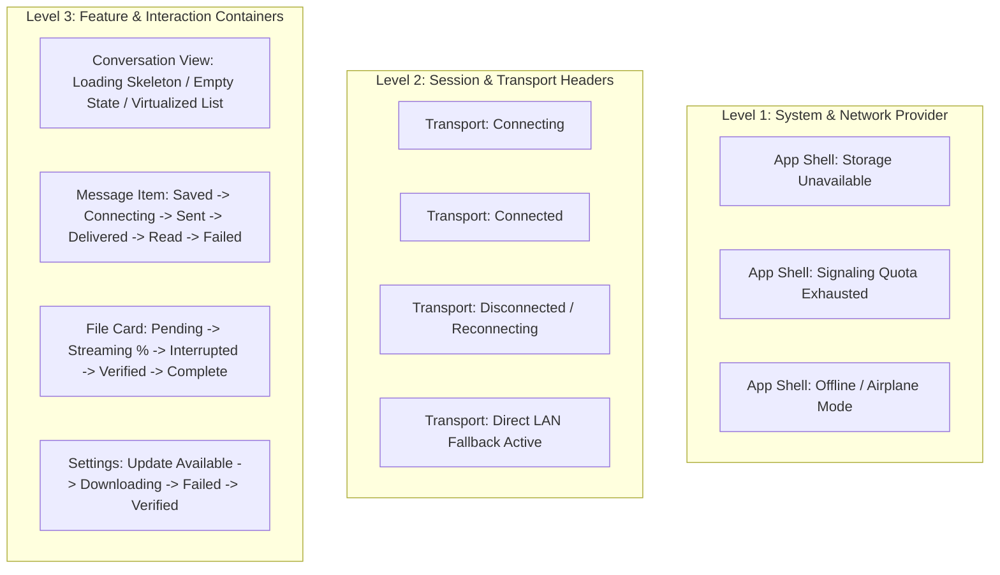
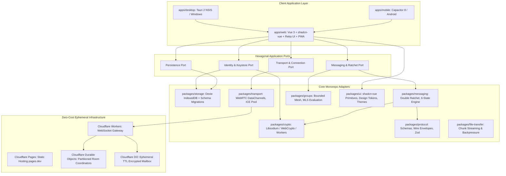
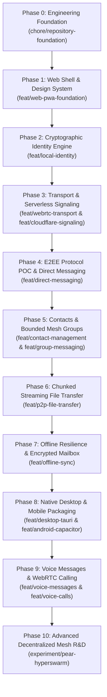

# CampusMesh: Master Implementation Plan & Engineering Specification

> **Document Type:** Production Engineering & Autonomous Development Master Specification  
> **Status:** Final Architectural Review Approved  
> **Target System:** Decentralized, Zero-Cost, Scalable, High-Performance Cross-Platform P2P Communication Platform  
> **Development Methodology:** Feature-Driven, Branch-Isolated, Open-Source Collaborative  
> **Repository Root:** `A:\Projects\CampusMesh`  
> **Budget Constraint:** Strictly $0.00 / month (Fail-Closed Free Tier Only)  
> **Frontend Stack:** Vue 3, TypeScript, Tailwind CSS, shadcn-vue, Reka UI, Lucide Icons, Vite, Pinia, Dexie  
> **Native Packaging:** Tauri 2 (Windows NSIS) & Capacitor 8 (Android)

---

## 1. Executive Summary & Core Architectural Manifesto

CampusMesh is a privacy-first, decentralized peer-to-peer (P2P) communication platform designed for college communities, student circles, and personal private communication.

### 1.1 The Three Core Architectural Priorities

1. **Prioritize Direct P2P Over Cloud Infrastructure:**  
   Cloudflare Workers and Durable Objects are strictly ephemeral coordinators for initial connection negotiation. They never store plaintext, retain permanent message histories, or act as a compulsory messaging backbone. Direct communication happens device-to-device via WebRTC DataChannels and local-first persistence.
2. **Architect for a Scalable Network from Day One:**  
   Decouple peer discovery, transport, message replication, encryption, and local storage into cleanly isolated ports and adapters (Hexagonal Architecture). Any individual layer (e.g., migrating from WebRTC DataChannels to Hyperswarm/Autobase) can evolve without re-architecting the application.
3. **Treat Premium UX and Performance as Core Features:**  
   Decentralized architecture must never compromise speed, beauty, or ergonomics. The application features a dedicated, tokenized design system built with **shadcn-vue** and **Reka UI**, complete state coverage (connecting, offline, quota exhausted, permission denied), conversation virtualization, and WebWorker-offloaded cryptography.

---

## 2. Architectural Corrections & Specific Governance Directives

### 2.1 Native Packaging Version Alignment

- **Desktop:** Tauri 2 (latest stable), packaging to Windows NSIS `.exe` installer with protocol handler (`campusmesh://`) and signed auto-updates.
- **Mobile:** **Capacitor 8.x** (latest stable compatible release) targeting Android SDK 34/35+, providing hardware access, background lifecycle hooks, and Android `PackageInstaller` handoff for APK updates.

### 2.2 Cloudflare WebSocket Hibernation & Quota Architecture

- **Workers Free Plan Limits:** 100,000 requests/day, 10ms CPU time/request.
- **Durable Objects Free Plan Limits:** 50,000 requests/day, 1GB SQLite storage.
- **WebSocket Hibernation API:**  
  `RoomCoordinatorDO` accepts connections via `this.ctx.acceptWebSocket(ws)`. While idle, the Durable Object hibernates and is evicted from memory, consuming **zero active CPU duration**. The DO wakes up only upon `webSocketMessage()` or client disconnection.
- **Exhaustion Behavior:**  
  Free Cloudflare accounts carry no linked payment method. If the daily 100k/50k quota is exhausted, Cloudflare returns HTTP `429 Too Many Requests` / error code `1027`. The system **fails closed**: zero bills can ever be incurred.
- **Client Degradation:** When signaling returns 429/connection error, the client sets `signalingStatus = 'UNAVAILABLE_QUOTA_EXHAUSTED'`, alerts the user, and transitions to manual signaling / LAN mode.

### 2.3 Realistic Manual Signaling & LAN Fallback

Browsers operate in a sandboxed execution context without access to raw UDP sockets, precluding mDNS broadcast directly from web JavaScript. The fallback operates across two tiers:

1. **Web Browser Fallback (Manual Connection Tokens):**
   - Peer A generates SDP Offer + local ICE candidates, compressed into a compact, Base45-encoded string or high-density QR Code.
   - Peer B scans/pastes the token and generates a Base45 Answer Token.
   - Peer A imports the Answer Token; direct WebRTC DataChannel connects without any server.
2. **Native Fallback (Desktop & Android Local LAN Discovery):**
   - Tauri (Rust) and Capacitor (Android) run native mDNS/SSDP background discovery services on the local Wi-Fi subnet. Peers on the same network discover each other automatically without external signaling.

### 2.4 Cryptographic Protocol Proof-of-Concept & Selection Gate

Ad-hoc combination of X25519 + AES-GCM is strictly categorized as a raw cryptographic building block, not a complete production messaging protocol.

- **Evaluation Gate (Phase 4):** Before locking the production protocol, we conduct a formal comparative POC between:
  1. **Double Ratchet / Signal Protocol:** Evaluated for 1-to-1 asynchronous messaging, providing immediate Forward Secrecy (FS) and Post-Compromise Security (PCS). Assessed via pure TypeScript/Wasm implementations for bundle size, skipped key derivation limits, and license compatibility (MIT/Apache 2.0).
  2. **MLS (Messaging Layer Security, RFC 9420):** Evaluated for scalable, verifiable group rekeying ($O(\log N)$ ratchet trees).
- **Production Lock Rule:** The production protocol will be selected only upon passing the evaluation benchmark and documented in `docs/adr/ADR-005-cryptographic-protocol-selection.md`.

### 2.5 Low-End Hardware & Network Performance Benchmarks

All performance metrics must be verified on realistic reference hardware:

- **Reference Low-End Mobile:** Android device with 3GB RAM, ARM Cortex-A55 octa-core (MediaTek Helio G35 / Snapdragon 680), Chrome for Android.
- **Reference Budget Laptop:** Intel Celeron / Core i3, 4GB RAM, Windows 10/11, Edge/Chrome.
- **Reference Unreliable Network:** 3G / throttled Wi-Fi profile (300ms RTT, 1% packet loss, 1.5 Mbps download, 750 kbps upload).

#### Hard Benchmark Targets:

| Metric                                | Budget Target                                      | Verification Method                                |
| ------------------------------------- | -------------------------------------------------- | -------------------------------------------------- |
| **Cold Startup to Interactive (TTI)** | < 2.0s (Desktop), < 2.8s (Mobile)                  | Lighthouse / Chrome DevTools                       |
| **Initial JS Bundle Size**            | < 150 KB (gzipped)                                 | Vite build output report                           |
| **Initial CSS Bundle Size**           | < 30 KB (gzipped)                                  | Vite build output report                           |
| **Active Chat Memory Footprint**      | < 65 MB RAM with 1,000 cached messages             | Chrome Memory Heap Profiler                        |
| **Message List Scroll Performance**   | Solid 60 FPS (Zero dropped frames on 10k messages) | Chrome Performance Panel (`@tanstack/vue-virtual`) |
| **Web Worker Cryptographic Step**     | < 15ms per ratchet step, < 800ms Argon2id KDF      | Performance.now() in Web Worker                    |
| **P2P Transfer Throughput**           | 1.5 - 5.0 MB/s (Local Wi-Fi), CPU < 15%            | DataChannel benchmark harness                      |

### 2.6 Scoped UX State Architecture

UX states are organized hierarchically across three distinct architectural levels, avoiding bloated, redundant states on atomic components:



### 2.7 Scalability Tiers

| Scalability Tier                                | Scope                         | Network Architecture                                              | Cryptographic Model                         |
| ----------------------------------------------- | ----------------------------- | ----------------------------------------------------------------- | ------------------------------------------- |
| **Tier 1: Direct 1-to-1 Messaging**             | MVP Core                      | Direct WebRTC DataChannels + STUN pool + Partitioned DO signaling | Double Ratchet / Signal Protocol (FS + PCS) |
| **Tier 2: Bounded Mesh Groups (2, 4, 8 Peers)** | Mid-term                      | Bounded small-mesh WebRTC topology + Outbox synchronization       | Group Ratchet / MLS RFC 9420 evaluation     |
| **Tier 3: Distributed Communities & Swarms**    | Advanced R&D (`experiment/*`) | Holepunch Pear / Hyperswarm / Hypercore append-only feeds         | Distributed Multi-Writer CRDTs / Autobase   |

### 2.8 Explicit System Limits & Resource Constraints

```text
Message & Payload Constraints:
├── Max Plaintext Message Size: 64 KB
├── Max Direct WebRTC File Attachment: 200 MB (Streamed in 16KB/64KB chunks with backpressure)
├── Max Offline Mailbox Attachment: 0 MB (Mailbox strictly rejects file attachments)
├── Max Offline Mailbox Message Size: 32 KB (Ciphertext only)
├── Max Stored Mailbox Messages: 50 messages per recipient
├── Max Mailbox Retention TTL: 48 Hours (Strict automatic SQLite eviction)
└── Max Durable Object Storage: 2 MB per room instance

Connection & Client Limits:
├── Max Concurrent WebRTC Peers: 8 peers (Mobile), 12 peers (Desktop)
├── RTCDataChannel Backpressure Low Threshold: 256 KB (Pause chunking if bufferedAmount > 1MB)
└── Local Storage Warning Threshold: Prompt cache eviction if IndexedDB exceeds 500 MB
```

### 2.9 Identity Hierarchy, Key Recovery & WebCrypto Implications

Generating WebCrypto keys with `extractable: false` prevents raw key theft via script injection, but makes raw key export impossible. CampusMesh resolves this using a **two-tier cryptographic key hierarchy**:

1. **Master Identity Entropy (Root Secret):**
   - 256-bit cryptographically secure seed (represented as a 24-word BIP-39 mnemonic).
   - The master seed is never stored in plaintext. It is encrypted in memory with a user-chosen passphrase using **Argon2id (time=3, mem=64MB) + AES-256-GCM** to generate an **Encrypted Identity Keystore**.
   - The encrypted keystore is persisted in IndexedDB.
2. **Session Signing & Agreement Keys:**
   - Ed25519 and X25519 session keys are deterministically derived from the root seed and imported into WebCrypto for high-speed operation.
3. **Backup & Recovery Protocol:**
   - **File Backup:** User enters passphrase; the client exports the encrypted keystore blob.
   - **Mnemonic Backup:** User views and writes down their 24-word recovery phrase.
   - **Device Linking (Pairing):** Primary device displays an ephemeral pairing QR code containing a temporary ECDH public key. The secondary device connects via WebRTC, undergoes mutual out-of-band confirmation (visual emoji / SAS code verification), and securely receives the encrypted keystore over an ephemeral E2EE channel.

### 2.10 Automated Visual Regression & Accessibility Testing

- **Visual Regression:** Playwright snapshot testing (`expect(page).toHaveScreenshot()`) across three standard viewports:
  - Desktop: 1920 × 1080
  - Tablet: 768 × 1024
  - Mobile: 375 × 667 (verifying 44×44px touch targets and virtual keyboard viewport resizing)
- **Automated Accessibility (a11y):** `@axe-core/playwright` audits integrated into CI, enforcing zero violations against **WCAG 2.2 Level AA** (color contrast, keyboard focus rings, screen-reader ARIA live regions for incoming messages).

### 2.11 Desktop Update Key Management & Disaster Recovery

- **Tauri 2 Update Signing:** Updates are signed with an Ed25519 private key.
- **Production Key Custody:**
  - `TAURI_SIGNING_PRIVATE_KEY` resides strictly in GitHub Actions Encrypted Secrets.
  - **Air-Gapped Cold Backup:** The private key is backed up offline in an encrypted hardware token (YubiKey / encrypted cold drive).
  - **Key Rotation Protocol (`ADR-007`):** Desktop application binaries embed a primary public key and a secondary disaster-recovery public key. If the primary key is compromised, updates signed by the recovery key can gracefully rotate the client trust anchor.

### 2.12 Zero-Cost Fail-Closed Provider Audit Table

| Provider / Service             | Free Tier Limits                                       | Fail-Closed Mechanism       | Exhaustion Behavior                                                       |
| ------------------------------ | ------------------------------------------------------ | --------------------------- | ------------------------------------------------------------------------- |
| **Cloudflare Pages**           | Unlimited bandwidth, 20,000 build mins/mo              | No credit card required     | Deployments queue; existing production site remains 100% active           |
| **Cloudflare Workers**         | 100,000 requests/day                                   | No payment method attached  | Returns HTTP 429 / 1027; client falls back to manual/LAN P2P              |
| **Cloudflare Durable Objects** | 50,000 requests/day, 1GB SQLite storage                | No payment method attached  | Returns HTTP 429; room coordinator halts; client falls back to manual P2P |
| **Google / Cloudflare STUN**   | Free public STUN servers                               | Unmetered public utility    | Automatic failover to secondary STUN in pool                              |
| **GitHub Actions**             | Unlimited for public repositories (2k mins/mo private) | Standard repository setting | Jobs queue if private quota hits; zero auto-billing                       |
| **GitHub Releases**            | Unlimited free release asset hosting                   | Free GitHub standard        | Update downloads throttled by GitHub CDN if abused                        |

---

## 3. High-Level Component Topology



---

## 4. Monorepo Architecture & Directory Layout

```text
campusmesh/
├── apps/
│   ├── web/                         # Vue 3 SPA + Vite + Tailwind + shadcn-vue + PWA
│   ├── desktop/                     # Tauri 2 Desktop container (Windows NSIS target)
│   └── mobile/                      # Capacitor 8 Android container
│
├── packages/
│   ├── shared-types/                # Core domain types, DTOs, wire schemas
│   ├── crypto/                      # WebCrypto / Libsodium engine, WebWorker offload
│   ├── storage/                     # Dexie IndexedDB adapter, queries, migration pipeline
│   ├── protocol/                    # Zod wire schemas, envelope validation, serialization
│   ├── transport/                   # ITransportAdapter, WebRTC DataChannels, STUN/ICE pool
│   ├── identity/                    # Key generation, QR card generation/scanning
│   ├── contacts/                    # Contact book, safety numbers, trust verification
│   ├── messaging/                   # Ratchet engine, 6 delivery states, conversation model
│   ├── groups/                      # Bounded mesh coordinator (2, 4, 8 peers), group rekeying
│   ├── file-transfer/               # Chunked binary streaming, backpressure, SHA-256 checks
│   ├── notifications/               # Cross-platform notification port (Browser + Native)
│   └── ui/                          # Design tokens, shadcn-vue & Reka UI components
│
├── infrastructure/
│   └── cloudflare/
│       ├── signaling-worker/        # WebSocket routing gateway
│       ├── room-coordinator/        # Partitioned Durable Object room coordinator (SQLite)
│       ├── encrypted-mailbox/       # TTL-bound ciphertext relay (optional offline)
│       └── wrangler.toml            # Fail-closed free tier Cloudflare configuration
│
├── docs/
│   ├── ARCHITECTURE.md              # System design & hexagonal port/adapter architecture
│   ├── SECURITY.md                  # Security disclosure policy & cryptographic design
│   ├── THREAT_MODEL.md              # Threat vectors, mitigations & boundary defenses
│   ├── COST_POLICY.md               # Zero-budget policy, free limits & fail-closed rules
│   ├── PERFORMANCE.md               # Low-end benchmarks, virtualization & profiling
│   ├── CONTRIBUTING.md              # Contributor guide & development workflow
│   ├── BRANCHING_STRATEGY.md        # Branch naming, stacked PRs & commit conventions
│   ├── ROADMAP.md                   # Real-time roadmap tracking
│   ├── IMPLEMENTATION_STATUS.md     # Feature verification matrix & Definition of Done
│   ├── PROTOCOL_SPECIFICATION.md    # Wire packet definitions & cryptographic handshakes
│   └── adr/                         # Architecture Decision Records (ADR-001 to ADR-008)
│
├── .github/
│   ├── ISSUE_TEMPLATE/              # Structured bug, feature, and security templates
│   ├── workflows/                   # Standard runner CI/CD pipelines
│   └── PULL_REQUEST_TEMPLATE.md     # Mandatory PR checklist & acceptance criteria
│
├── tests/
│   ├── unit/                        # Workspace-wide unit tests
│   ├── integration/                 # WebRTC loopback and multi-package integration
│   ├── e2e/                         # Playwright cross-browser multi-context tests
│   └── security/                    # Cryptographic fuzzing and replay tests
│
├── pnpm-workspace.yaml              # Monorepo workspace configuration
├── package.json                     # Root configuration, scripts, devDependencies
├── tsconfig.base.json               # Shared strict TypeScript configuration
└── vitest.workspace.ts              # Unified Vitest workspace runner
```

---

## 5. Phase-by-Phase Roadmap (Phases 0 through 10)



### Detailed Phase Specifications

#### Phase 0: Engineering Foundation & Monorepo Toolchain

- **Branch:** `chore/repository-foundation`
- **Scope:** Root monorepo setup, strict TypeScript, linting, formatting, testing harness, CI pipeline, and core governance documents.
- **Key Deliverables:**
  - `pnpm-workspace.yaml`, root `package.json` with scripts (`build`, `test`, `lint`, `typecheck`).
  - Strict `tsconfig.base.json` with project references.
  - ESLint 9 (flat config) + Prettier + Husky + lint-staged.
  - Vitest workspace configuration (`vitest.workspace.ts`).
  - Core Documentation:
    - `docs/ARCHITECTURE.md` (Hexagonal architecture, ports & adapters)
    - `docs/COST_POLICY.md` (Hard $0.00 budget, free-tier quotas, fail-closed behavior)
    - `docs/PERFORMANCE.md` (Low-end hardware budgets, virtualization, profiling)
    - `docs/SECURITY.md` & `docs/THREAT_MODEL.md` (Cryptographic hygiene, zero secret logging)
    - `docs/CONTRIBUTING.md` & `docs/BRANCHING_STRATEGY.md`
    - `docs/ROADMAP.md` & `docs/IMPLEMENTATION_STATUS.md`
    - Initial ADRs: `ADR-001` (Monorepo), `ADR-002` (WebRTC + DO), `ADR-003` (Zero-Cost Policy), `ADR-004` (shadcn-vue + Reka UI Design System).
  - GitHub Actions standard CI pipeline (`.github/workflows/ci.yml`).

#### Phase 1: Web Application Shell & Premium Design System

- **Branch:** `feat/web-pwa-foundation`
- **Packages/Apps:** `apps/web`, `packages/ui`
- **Key Deliverables:**
  - Vue 3 + Vite + Tailwind CSS + `shadcn-vue` + `Reka UI` + `lucide-vue-next`.
  - Design tokens: Colors (Dark/Light/High-Contrast), typography, elevation, radii, motion tokens.
  - Responsive App Shell:
    - Desktop: Collapsible navigation sidebar, conversation selector, main chat pane, details drawer, Command Palette (`Cmd+K` / `Ctrl+K`).
    - Mobile: Mobile-first layout, bottom navigation tabs, touch-optimized headers, safe-area inset handling.
  - Scoped UX state primitives (Level 1 System alerts, Level 2 Transport indicators, Level 3 Skeletons/Empty states).
  - PWA integration via `vite-plugin-pwa` with offline caching service worker.

#### Phase 2: Cryptographic Identity Engine & Local Keystore

- **Branch:** `feat/local-identity`
- **Packages:** `packages/crypto`, `packages/storage`, `packages/identity`
- **Key Deliverables:**
  - `@campusmesh/crypto`: Pure cryptographic primitives using `libsodium-wrappers` and Web Crypto API. Ed25519 signing and X25519 key exchange.
  - WebWorker crypto bridge for offloading key generation and Argon2id key derivation outside the UI thread.
  - `@campusmesh/storage`: Dexie IndexedDB schemas with atomic transactions and version migrations.
  - Zero private keys in `localStorage`. Two-tier key hierarchy (Argon2id + AES-256-GCM master keystore).
  - `@campusmesh/identity`: Identity manager creating local profiles (Public Key, SHA-256 fingerprint, Display Name, local avatar).
  - QR Code generator and video stream scanner component (`@zxing/library`).
  - Encrypted backup export/import and pairing handshake protocol.

#### Phase 3: Transport Layer & Partitioned Serverless Signaling

- **Branches:** `feat/webrtc-transport` (Client) & `feat/cloudflare-signaling` (Infra)
- **Packages/Infra:** `packages/transport`, `packages/protocol`, `infrastructure/cloudflare`
- **Key Deliverables:**
  - `packages/transport`: `ITransportAdapter` port abstraction. `WebRtcTransportAdapter` implementation managing `RTCPeerConnection` and `RTCDataChannel`.
  - STUN pool configuration with free public servers (Google STUN, Cloudflare STUN) and exponential backoff reconnection.
  - Fallback signaling: Base45/QR manual token exchange (Web) and mDNS discovery (Native).
  - Cloudflare Worker + Durable Object Room Coordinator:
    - Partitioned by conversation ID: `RoomCoordinatorDO` handles only its own room peers.
    - Zero plaintext message handling; exchanges only encrypted SDP/ICE messages.
    - WebSocket Hibernation API utilized for zero CPU consumption during idle states.
    - Automatic room expiration (15-minute TTL) and IP/origin rate limiting.

#### Phase 4: E2EE Protocol Evaluation & Direct Messaging Engine

- **Branch:** `feat/direct-messaging`
- **Packages:** `packages/protocol`, `packages/messaging`, `packages/storage`, `apps/web`
- **Key Deliverables:**
  - Cryptographic Protocol Proof-of-Concept & Selection:
    - Evaluate mature Double Ratchet / Signal Protocol vs MLS RFC 9420.
    - Verify Forward Secrecy (FS), Post-Compromise Security (PCS), and out-of-order message handling.
    - Document security review in `ADR-005` before locking the production protocol.
  - Wire protocol envelopes with Zod runtime validation.
  - 6-State Delivery Tracking Engine:
    1. `SAVED_LOCALLY` -> 2. `CONNECTING` -> 3. `SENT` -> 4. `DELIVERED` (cryptographic ACK) -> 5. `READ` (read receipt ACK) -> 6. `FAILED` (network timeout).
  - Virtualized Message List: `@tanstack/vue-virtual` handling seamless 60 FPS scrolling for 10,000+ messages.
  - UI Features: Optimistic updates, delivery tick marks, message replies, inline emoji reactions, full-text IndexedDB search.

#### Phase 5: Contact Management & Bounded Mesh Groups

- **Branches:** `feat/contact-management` & `feat/group-messaging`
- **Packages:** `packages/contacts`, `packages/groups`, `packages/storage`, `apps/web`
- **Key Deliverables:**
  - Contact management: QR contact exchange, deep link invites (`campusmesh://invite/...`), fingerprint verification (Safety Numbers), contact blocking/unblocking.
  - Small-Group Mesh Architecture:
    - Tested, bounded mesh topology (benchmarked at 2, 4, and 8 peers).
    - Resource monitoring: track active connection count, CPU, and memory.
  - Authenticated group membership: Signed member join, leave, role update (Owner, Admin, Member), and invite revocation.
  - Group key distribution and group ratcheting.

#### Phase 6: Chunked Streaming File Transfer with Backpressure

- **Branch:** `feat/p2p-file-transfer`
- **Packages:** `packages/file-transfer`, `packages/transport`, `apps/web`
- **Key Deliverables:**
  - WebRTC DataChannel binary streaming with 16KB/64KB chunking.
  - Flow control & backpressure management using `bufferedAmount` and `bufferedAmountLowThreshold` (pause if > 1MB buffered).
  - Zero server upload: Direct peer-to-peer binary transfer (up to 200MB).
  - End-to-end streaming SHA-256 integrity check.
  - Transfer states: Pause, resume, cancel, and live progress indicators.
  - File previewers: Image lightbox, audio waveform preview, PDF/document download.

#### Phase 7: Offline Resilience & Ephemeral TTL Mailbox

- **Branch:** `feat/offline-sync`
- **Packages/Infra:** `packages/messaging`, `infrastructure/cloudflare/encrypted-mailbox`
- **Key Deliverables:**
  - Outbox pattern in IndexedDB: Messages queued while offline automatically flush when peer reconnects.
  - Ephemeral Encrypted Mailbox (Cloudflare Durable Object):
    - Free-tier compliant, optional ciphertext relay (max 32KB per message, max 50 messages per recipient, 48-hour hard TTL).
    - Ed25519 signature verification on submission.
    - Immediate hard deletion upon recipient download and ACK.
    - Fail-closed behavior: If quota is exceeded, mailbox turns off gracefully and app reverts to direct P2P queue.

#### Phase 8: Cross-Platform Native Applications (Tauri 2 & Capacitor 8)

- **Branches:** `feat/desktop-tauri` & `feat/android-capacitor`
- **Apps:** `apps/desktop`, `apps/mobile`
- **Key Deliverables:**
  - **Desktop (Windows NSIS):**
    - Tauri 2 packaging wrapping the shared Vue 3 frontend.
    - NSIS installer with desktop shortcuts and `campusmesh://` protocol handler.
    - Tauri auto-updater wired to GitHub Releases with Ed25519 signature verification and dual-key rotation recovery.
  - **Mobile (Android APK):**
    - Capacitor 8 configuration targeting Android SDK 34+.
    - Android APK build workflow via GitHub Actions standard runners.
    - In-app update checker querying GitHub Releases and launching the native Android `PackageInstaller`.

#### Phase 9: Voice Messages & 1-to-1 WebRTC Calling

- **Branches:** `feat/voice-messages` & `feat/voice-calls`
- **Packages:** `packages/messaging`, `packages/transport`, `apps/web`
- **Key Deliverables:**
  - Voice notes: Audio recording via `MediaRecorder` (Opus/WebM), interactive waveform visualizer, chunked encrypted P2P transfer, inline playback.
  - 1-to-1 WebRTC Audio/Video Calls:
    - WebRTC media stream negotiation (`getUserMedia`).
    - Ephemeral call invitation, ringing, acceptance, rejection, and camera/mic/screen-share toggles.
    - Explicit zero-cost boundary: Large group video calls requiring paid SFUs are strictly excluded.

#### Phase 10: Advanced Decentralized Mesh R&D (Pear/Hyperswarm)

- **Branch:** `experiment/pear-hyperswarm`
- **Key Deliverables:**
  - Isolated research spike evaluating Holepunch Pear, Hyperswarm, Hypercore, HyperDHT, and Autobase.
  - Benchmark report comparing NAT traversal rates, memory footprints, Windows and Android compatibility, and storage replication reliability against the WebRTC baseline.
  - `ADR-008` documenting findings and long-term integration feasibility.

---

## 6. Immediate Phase 0 Execution Checklist

Execution begins immediately on branch `chore/repository-foundation`:

- [ ] **Step 0.1: Git Repository Initialization**
  - Run `git init` in `A:\Projects\CampusMesh`.
  - Establish `main` as the default branch.
  - Check out new branch: `git checkout -b chore/repository-foundation`.
- [ ] **Step 0.2: Monorepo Root Configuration**
  - Create `pnpm-workspace.yaml`.
  - Create root `package.json` with workspace devDependencies and lifecycle scripts (`dev`, `build`, `test`, `lint`, `typecheck`, `format`).
  - Create strict `tsconfig.base.json`.
  - Create `.gitignore`, `.prettierrc`, and `eslint.config.js`.
- [ ] **Step 0.3: Directory Skeleton Scaffolding**
  - Scaffold `apps/web`, `apps/desktop`, `apps/mobile`.
  - Scaffold `packages/shared-types`, `packages/crypto`, `packages/storage`, `packages/protocol`, `packages/transport`, `packages/identity`, `packages/contacts`, `packages/messaging`, `packages/groups`, `packages/file-transfer`, `packages/notifications`, `packages/ui`.
  - Scaffold `infrastructure/cloudflare`.
  - Scaffold `docs/` and `docs/adr/`.
  - Scaffold `.github/workflows/` and `.github/ISSUE_TEMPLATE/`.
- [ ] **Step 0.4: Governance & Architectural Documentation**
  - Write `docs/ARCHITECTURE.md` (Hexagonal architecture, ports & adapters).
  - Write `docs/COST_POLICY.md` (Strict $0.00 budget, free-tier quotas, fail-closed behavior).
  - Write `docs/PERFORMANCE.md` (Low-end hardware benchmarks, virtualization, profiling).
  - Write `docs/SECURITY.md` & `docs/THREAT_MODEL.md`.
  - Write `docs/CONTRIBUTING.md` & `docs/BRANCHING_STRATEGY.md`.
  - Write `docs/ROADMAP.md` & `docs/IMPLEMENTATION_STATUS.md`.
  - Write initial ADRs: `ADR-001` (Monorepo), `ADR-002` (WebRTC + DO), `ADR-003` (Zero-Cost Policy), `ADR-004` (shadcn-vue + Reka UI Design System).
- [ ] **Step 0.5: CI Pipeline & Quality Gates**
  - Create `.github/workflows/ci.yml` for pull request verification (Lint, Typecheck, Test, Build).
  - Create `.github/PULL_REQUEST_TEMPLATE.md` with Definition of Done checklist.
- [ ] **Step 0.6: Validation & Verification**
  - Run `pnpm install`, `pnpm typecheck`, `pnpm lint`, `pnpm test`.
  - Ensure 100% clean exit codes.
- [ ] **Step 0.7: Commit & Merge Preparation**
  - Commit all foundational files using Conventional Commits (`chore(repo): establish monorepo foundation, governance, and CI`).
  - Merge into `main` and tag baseline.

---

_All 12 review directives have been incorporated into this master specification. The plan is verified and locked for execution._
