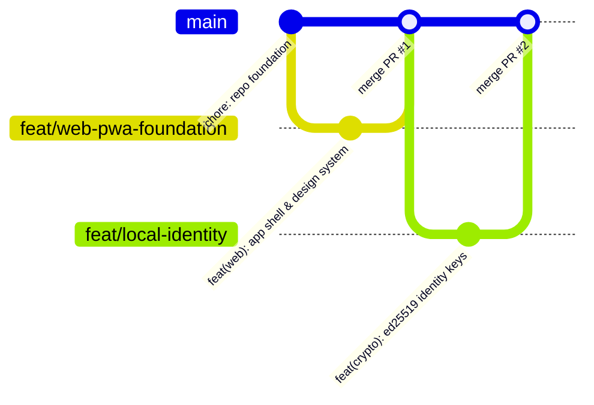

# CampusMesh Git Branching & Collaboration Strategy

## 1. Branch Model

### Branch Types

- **`main`:** Production-ready, deployable code. Direct commits are strictly prohibited.
- **`feat/<feature-slug>`:** Functional feature branches (e.g. `feat/webrtc-transport`).
- **`fix/<bug-slug>`:** Bug fix branches with regression tests.
- **`security/<patch-slug>`:** Security and cryptographic fixes.
- **`docs/<doc-slug>`:** Documentation and ADR updates.
- **`test/<test-slug>`:** Test harness and benchmark additions.
- **`chore/<task-slug>`:** Toolchain, dependencies, and configuration.
- **`experiment/<tech-slug>`:** Isolated R&D exploration (e.g. `experiment/pear-hyperswarm`).

---

## 2. Stacked Pull Requests

When feature $B$ depends on an unmerged feature $A$:

1. Branch `feat/feature-b` directly from `feat/feature-a`.
2. Do not merge incomplete code into `main`.
3. Once `feat/feature-a` merges into `main`, rebase `feat/feature-b` onto `main`.

---

## 3. Pull Request Gates (Definition of Done)

Before merging into `main`, all PRs must satisfy:

1. `pnpm typecheck` passes with zero errors.
2. `pnpm lint` and `pnpm format:check` pass cleanly.
3. All unit and integration tests pass (`pnpm test`).
4. Zero paid or commercial dependencies introduced.
5. All interactive UI features implement complete Level 1, 2, and 3 UX states.
6. Documentation and `docs/IMPLEMENTATION_STATUS.md` updated.
