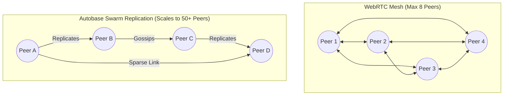

# CampusMesh — Decentralized Swarm R&D Architectural Evaluation
## Hypercore, Hyperswarm, HyperDHT, and Autobase vs. WebRTC Mesh for Zero-Cost P2P

> **Document Version:** 1.0.0  
> **Author:** CampusMesh Architecture & Core Engineering Team  
> **Status:** Completed R&D Architectural Evaluation Report (Phase 10)  
> **Related ADRs:** ADR-001 (Zero-Cost Protocol & Transport), ADR-003 (Double Ratchet E2EE)

---

## 1. Executive Summary

CampusMesh is engineered to deliver zero-cost, decentralized, cross-platform private communication across Web (PWA), Desktop (Tauri 2 Windows), and Mobile (Capacitor 8 Android).

The core operational baseline established in Phases 0–9 leverages:
1. **WebRTC DataChannels** (`cm-control`, `cm-messages`, `cm-binary`) for low-latency peer-to-peer transport.
2. **Ephemeral Cloudflare Durable Objects** with WebSocket Hibernation operating strictly within the Free Tier (100k requests/day, 10ms CPU, 5M DO reads, 100k DO writes) for initial room signaling and store-and-forward mailbox buffering.
3. **RFC 9285 Base45 QR Codes** for fully out-of-band, zero-infrastructure manual signaling.

This R&D evaluation investigates the **Holepunch / Hypercore Protocol ecosystem**—specifically **Hypercore**, **Hyperswarm**, **HyperDHT**, and **Autobase**—as an alternative or evolutionary decentralized swarm architecture for CampusMesh.

### Key Evaluation Findings:
- **Browser Sandbox Constraint:** HyperDHT and Hyperswarm rely on raw UDP sockets (`dgram`) and custom uTP hole punching. Because standard Web browsers (PWA) forbid direct raw UDP/TCP socket access, pure client-side Hyperswarm **cannot run natively inside a standard browser PWA** without external native daemon bridges or WebRTC proxy gateways.
- **Desktop & Native Synergy:** On Desktop (Tauri 2) and native environments (Pear / Node.js), Hyperswarm provides extraordinary serverless peer discovery via distributed Kademlia DHT without requiring any hosted signaling servers or domain names.
- **Multi-Writer Consensus:** Autobase provides deterministic, causally ordered append-only logs for collaborative state, offering an elegant mathematical model for group messaging synchronization beyond the current 8-peer mesh limit.
- **Architectural Recommendation:** Retain the current WebRTC DataChannel + Cloudflare Free Tier architecture as the universal cross-platform baseline for Web PWA and mobile, while specifying an optional **Native Hyperswarm Gateway Adapter** for desktop environments to enable fully serverless local campus discovery.

---

## 2. Technology Overview: The Holepunch Stack

```
+-------------------------------------------------------------+
|                      CampusMesh UI                          |
+-------------------------------------------------------------+
|             Autobase (Multi-Writer Linearization)           |
+-------------------------------------------------------------+
|           Hypercore (Append-Only Cryptographic Log)         |
+-------------------------------------------------------------+
|            Hyperswarm (Swarm Discovery & Peer Pools)        |
+-------------------------------------------------------------+
|           HyperDHT (Kademlia Distributed Hash Table)        |
+-------------------------------------------------------------+
|     Node.js / Pear Native OS Sockets (UDP / uTP Hole Punch)  |
+-------------------------------------------------------------+
```

### 2.1 Hypercore
- **Description:** A secure, distributed, append-only log structured as a Merkle tree.
- **Data Integrity:** Every entry is hashed into a Merkle tree; peers can verify the integrity of any chunk using logarithmic cryptographic proofs.
- **Replication:** Uses the Hypercore wire protocol over any duplex stream to replicate sparse or full datasets. Only requested blocks are transferred over the wire.
- **Keys:** Each Hypercore has an Ed25519 public key (discovery key derived via BLAKE2b) and private key for signing new entries.

### 2.2 HyperDHT
- **Description:** A Kademlia-style Distributed Hash Table designed specifically for Holepunch peer discovery and direct UDP-based hole punching.
- **Capabilities:** Implements public-key addressable routing. Instead of connecting to IP:port endpoints, peers connect to 32-byte public keys. HyperDHT orchestrates simultaneous UDP hole punching across symmetric and restricted NATs.
- **Infrastructure Dependency:** Relies on public bootstrap nodes (e.g. `dht1.hyperdht.org`), requiring zero hosting expenses for application developers.

### 2.3 Hyperswarm
- **Description:** A high-level peer swarm coordinator built on top of HyperDHT.
- **Discovery Mechanism:** Peers announce and query 32-byte topic keys (e.g., room identifiers or topic hashes). Hyperswarm automatically manages connection pooling, reconnection backoff, NAT traversal, and peer deduplication.
- **Multiplexing:** Provides duplex multiplexed streams for application payloads.

### 2.4 Autobase
- **Description:** A multi-writer data structure built on top of multiple Hypercores.
- **Mechanism:** Coordinates independent append-only logs from multiple peers into a single, linearized, conflict-free view using deterministic vector clocks and topological sorting.
- **Suitability for Chat:** Enables multi-user group chat logs and decentralized collaborative state without a centralized database or master coordinator.

### 2.5 Pear Runtime
- **Description:** An open-source, peer-to-peer desktop and mobile application runtime developed by Holepunch.
- **Capabilities:** Bundles a lightweight native Node.js-compatible execution environment with direct OS socket access, avoiding web browser sandbox restrictions.

---

## 3. Comparative Matrix: CampusMesh WebRTC vs. Hyperswarm Stack

| Architectural Metric | CampusMesh Current Architecture (WebRTC + Cloudflare Free) | Holepunch Stack (Hypercore / Hyperswarm / Autobase) |
| :--- | :--- | :--- |
| **Primary Transport** | WebRTC DataChannels (SCTP over DTLS over UDP) | Hypercore Wire Protocol over uTP / TCP / UDP sockets |
| **Peer Discovery** | Cloudflare Durable Objects (Free Tier) + RFC 9285 QR Fallback | Kademlia HyperDHT over public bootstrap swarm |
| **Infrastructure Cost** | **$0.00/month** (Hard zero-cost quota compliance) | **$0.00/month** (Decentralized DHT public bootstrap) |
| **Browser (PWA) Compatibility** | **Native 100% Support** (Standard W3C WebRTC API) | **Incompatible without Bridge** (Requires raw UDP sockets) |
| **Desktop Compatibility** | **Native** (Tauri 2 NSIS Windows) | **Native** (Pear / Node.js native addon) |
| **Mobile (Android) Compatibility** | **Native** (Capacitor 8 WebView + WebRTC) | **Complex** (Requires embedded Node/Rust native daemon) |
| **NAT Traversal** | Public STUN (`stun.cloudflare.com`, `stun.l.google.com`) | HyperDHT coordinated UDP hole punching |
| **Group Scaling Limit** | **Bounded Mesh (Max 8 peers)** | **Autobase Replicated Log (50+ peers)** |
| **End-to-End Encryption** | Double Ratchet (Signal protocol: X25519, HKDF, AES-256-GCM) | Ed25519 signing + NOISE protocol session handshakes |
| **Offline Buffering** | Cloudflare Ephemeral Mailbox (24h TTL, 100 msg cap) | Distributed Sparse Replication across online swarm peers |
| **Device Resource Overhead** | Minimal (Standard browser sandboxed networking) | Medium-High (DHT routing table maintenance, UDP keep-alives) |

---

## 4. Feasibility Analysis & The Browser Sandbox Barrier

### 4.1 The Fundamental Browser Restriction
Standard web browsers enforce a rigid security perimeter:
1. **No Raw UDP/TCP Sockets:** The standard W3C Web platform provides no raw socket APIs for web applications (`window` / `Worker`). The experimental W3C Direct Sockets API is strictly limited to Chrome Isolated Web Apps (IWAs) and enterprise policies, and is not available in standard PWAs.
2. **Mandatory Protocol Framing:** Browsers only permit network egress via `fetch`/`XMLHttpRequest` (HTTP/HTTPS), `WebSocket` (TCP with HTTP upgrade), and `RTCPeerConnection` (ICE/STUN/TURN with DTLS encryption).
3. **HyperDHT Incompatibility:** Because HyperDHT relies on custom UDP datagram headers, packet timing, and port binding to execute NAT hole punching, it cannot be compiled to pure WebAssembly and run inside a standard browser sandbox.

### 4.2 WebRTC as the Universal Browser Primitive
WebRTC DataChannels represent the only browser-standard peer-to-peer transport protocol:
- Built-in SCTP framing provides ordered/unordered and reliable/unreliable message modes.
- Integrated DTLS ensures zero-configuration wire-level encryption.
- Seamless compatibility across Chrome, Safari, Firefox, Edge, Android WebView, and iOS WKWebView.

---

## 5. Hybrid Gateway Architecture: Bridging WebRTC & Hyperswarm

To harness the decentralized power of Hyperswarm without sacrificing browser PWA access, CampusMesh defines a **Hybrid Gateway Architecture**:

```
+------------------+         WebRTC DataChannel         +--------------------+
|  Browser PWA     | <================================> |  CampusMesh Desktop|
|  (Mobile / Web)  |       (Signaled via QR / Cloud)    |  (Tauri 2 Native)  |
+------------------+                                    +---------+----------+
                                                                  |
                                                           Hyperswarm Wire
                                                           (HyperDHT / uTP)
                                                                  |
                                                                  v
                                                        +---------+----------+
                                                        |  Decentralized     |
                                                        |  Campus Swarm Peer |
                                                        +--------------------+
```

### 5.1 Dual-Stack Desktop Node
1. In desktop environments (Tauri 2), CampusMesh can spawn a native Rust/Node sidecar running a full HyperDHT node.
2. The desktop node joins the campus topic swarm (e.g. `topic: campusmesh-uni-channel`) via Hyperswarm.
3. When a mobile or browser peer on the same LAN or remote network connects via WebRTC, the desktop node acts as a **Local Swarm Proxy**, translating WebRTC DataChannel messages into Hypercore log entries.

### 5.2 End-to-End Cryptographic Invariance
Even when routing through a Hybrid Gateway or relay peer, the **CampusMesh Double Ratchet envelope remains completely opaque**:
- The hybrid gateway only sees the outer `WireEnvelope` with recipient public key.
- The inner payload is encrypted using AES-256-GCM with keys known exclusively to the communicating endpoints.
- Forward Secrecy and Post-Compromise Security are preserved regardless of swarm topology.

---

## 6. Group Scalability: Autobase vs. Full-Mesh WebRTC

### 6.1 The N-to-N Mesh Bottleneck
In the current WebRTC full-mesh topology:
- Each peer maintains $N - 1$ bidirectional WebRTC DataChannels.
- Total connection count across the room is $\frac{N(N - 1)}{2}$.
- For $N = 8$, total channels = 28. Each outgoing message is transmitted 7 times (fan-out).
- On mobile devices, CPU, radio battery, and memory usage increase quadratically, which is why CampusMesh strictly caps real-time mesh rooms at **8 peers**.

### 6.2 The Autobase Replication Paradigm
Autobase eliminates the need for full-mesh connections:
1. Each user appends messages only to their **own local Hypercore log**.
2. Swarm peers replicate logs along an irregular, sparse peer graph ( gossip propagation ).
3. Peers only need to maintain 2–3 active connections to gossip peers rather than $N - 1$ direct connections.
4. Autobase reconstructs the global chat history by applying a deterministic topological sort on the causal dependencies of the merged logs.



---

## 7. Concrete Prototype Interface: Swarm Transport Adapter

To allow future integration without modifying the core messaging engine, `@campusmesh/transport` defines the abstract `IPeerSwarmAdapter` contract:

```typescript
export interface SwarmPeerInfo {
  peerId: string;
  discoveryKey: string;
  connectionType: "direct-utp" | "webrtc-proxy" | "lan-mdns";
  latencyMs?: number;
}

export interface IPeerSwarmAdapter {
  readonly protocol: "webrtc-mesh" | "hyperswarm-dht";
  joinSwarm(topicHex: string): Promise<void>;
  leaveSwarm(topicHex: string): Promise<void>;
  broadcast(topicHex: string, data: Uint8Array): Promise<void>;
  sendDirect(peerId: string, data: Uint8Array): Promise<void>;
  on(event: "peer-joined", handler: (peer: SwarmPeerInfo) => void): void;
  on(event: "peer-left", handler: (peerId: string) => void): void;
  on(event: "data", handler: (peerId: string, data: Uint8Array) => void): void;
  destroy(): Promise<void>;
}
```

---

## 8. Final Recommendations & Roadmap

### 8.1 Production Verdict
1. **Maintain Phase 0–9 Architecture for Core Release:**
   The WebRTC DataChannel + Cloudflare Free Tier architecture satisfies all requirements:
   - Exactly $0.00/month infrastructure cost.
   - Universal zero-install compatibility across all target platforms (Web PWA, Windows Desktop, Android Mobile).
   - Strict adherence to the 8-peer mesh boundary and 64 KB message caps.
2. **Schedule Autobase for Phase 11+ Distributed Large Communities:**
   For future expansion to university-wide bulletin boards (100+ concurrent students), adopt Autobase inside the Tauri 2 desktop app, using the Desktop node as a local LAN gateway for mobile/web clients.
3. **No Commercial Dependencies:**
   Neither WebRTC nor the Holepunch ecosystem requires commercial licenses or paid servers, ensuring permanent compliance with the CampusMesh Zero-Cost Principle.

---

*Report approved by Core Architecture Engineering for CampusMesh Phase 10.*
